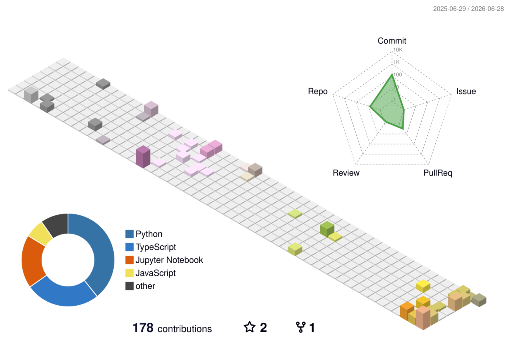
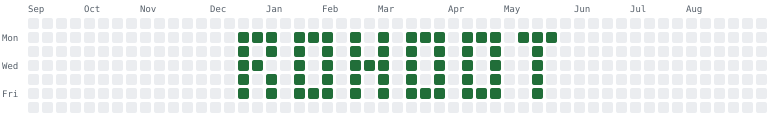

<p align="center">
  
</p>

<p align="center">
  
</p>

<p align="center">
  <a href="https://www.linkedin.com/in/rohit-panda/">
    
  </a>
  <a href="https://github.com/Roh00t">
    
  </a>
  <a href="mailto:pandarohit05@gmail.com">
    
  </a>
</p>

<p align="center">
  
  &nbsp;
  
  &nbsp;
  
  &nbsp;
  
  &nbsp;
  
  &nbsp;
  
  &nbsp;
  
</p>

---

## 🎓 Certifications

<p align="center">
  <a href="https://www.credly.com/badges/d2a45bcc-e3c7-4774-badb-0dc9cc749947">
    
  </a>
  &nbsp;
  <a href="https://www.credly.com/badges/ed81edaf-eb25-425b-8abe-9086a9e0561d">
    
  </a>
</p>

---

## `$ whoami`

```
Location  : Singapore
Current   : NTU MSc in Enterprise AI (2026 – 2027)
Internship: Jiwa Robotics — Embodied AI Intern (Dec 2026 – May 2027)
Prev      : Singtel SOC (Security Analyst, Sept 2025 – June 2026)
Building  : Killswitch (counter-UAS tracking brain) | PES Progress (CV fitness trainer)
Shipped   : ClauseGuard | Gavin-AI | PES | EDDA | Retrofit Radar (hackathon, 1st place)
Learning  : Embodied AI — LeRobot, VLA models (AgiBot GO-1), imitation learning, ROS 2
Exploring : Voice AI for ageing-in-place | Tennis match-analysis CV
Background: SPF Trainer (Jurong Div) | IBM | Accenture | MHA Innovation Award (SETS)
Interests : Security × AI | Embodied AI & robotics | Healthcare tech | CTF | Tennis | Martial arts | Running
```

---

## 🧭 Now & Next

| When | What |
|------|------|
| **Now** | MSc in Enterprise AI @ NTU — agentic AI, AI-driven cybersecurity, enterprise automation |
| **Now** | **Killswitch** — building a tracking-first counter-UAS prototype as an independent startup; NTU GET Innovation Grant application submitted |
| **Now** | **PES Progress** — free tier in build, waitlist open, recruiting IPPT-cleared pilot users (NSFs, NSmen, Regulars) |
| **Dec 2026 – May 2027** | **Embodied AI Intern @ Jiwa Robotics** — ML model training, data collection & cleaning, robot "neural brain", ROS 2 / Open RMF |
| **Dec 2026 – Jan 2027** | AWS Solutions Architect – Associate · Claude Certified Architect – Foundations |
| **2027** | MSc completion |

---

## 🛠️ Tech Stack

**Languages & Frameworks**

<p align="center">
  
</p>

**Security Operations**

<p align="center">
  
  
  
  
  
  
  
  
</p>

**📚 Currently Learning — Embodied AI & Robotics**

*Preparing for the Jiwa Robotics internship. Learning, not yet shipped — these move into the stack above once I've used them on real robots.*

| Area | What I'm working through |
|------|--------------------------|
| Robot learning data | LeRobot dataset format — loading, visualising and quality-checking episodes (camera streams, states, actions) |
| Vision-language-action models | AgiBot World dataset and the open GO-1 codebase — pretrained checkpoints, fine-tuning, open-loop evaluation |
| Data capture | Handheld and egocentric demonstration capture, and converting recordings into training inputs |
| Imitation learning | Action chunking, demonstration consistency, how policy success rate is measured |
| Robot middleware | ROS 2 fundamentals — nodes, topics, bag recording, coordinate frames |
| Infrastructure | Linux, Docker, GPU setup and networking for robot deployments |

---

## 🚀 Projects

| | Project | Description | Stack | Status |
|--|---------|-------------|-------|--------|
| 🛰️ | **[Killswitch](https://kill-switch-website.vercel.app/)** | Counter-UAS targeting *brain* — detect → track → predict → aim → human gate — built "track first, mount anything": the tracking stack is the product, effectors are modular. Runs today on a webcam, an ESP32 and a ~$200 gimbal, designed to re-host without a rewrite. Firmware-enforced safety (deadman timer, burn ceiling, checksummed arming). Started at SDTH 2026, now an independent team of four; I lead and own software & safety, including the detection / tracking / prediction stack | Python, YOLOv11, ByteTrack, Kalman, ESP32/C++, MQTT | 🏆 SDTH 2026 → 🚀 Building as startup |
| 💪 | **[PES Progress](https://roh00t.github.io/PES/)** | Computer-vision IPPT trainer — camera rep counting for push-ups and sit-ups, 60-second test mode with voice cues, GPS lap tracker for the 2.4 km run, AI coach. Fully client-side, no video leaves the device. Spiritual successor to SETS; now being built out as a product | MediaPipe, JS, Web APIs | ✅ Live → 🚀 Building as startup |
| 🤖 | **[Gavin-AI](https://roh00t.github.io/Gavin-AI/)** | Self-hosted multi-tenant AI agent workspace — run isolated agent environments with profiles, tools, and channels per tenant | Python, AI Agents, Multi-tenant | ✅ Live |
| 📜 | **[ClauseGuard](https://clausegaurd-hm9g.onrender.com/)** | AI employment contract analyser — clause-level risk scoring on Singapore employment contracts, built at AIForge SMU 2026 | FastAPI, Supabase, TokenRouter | ✅ Live |
| ✈️ | **[Flight Disruption Negotiator](https://acasiahackathon.vercel.app/)** | Multi-agent system where ATC, Pilot and Ground agents negotiate flight disruptions, grounded in 2015 US DOT delay data — Airbus AI & Aerospace track, Autonomous SG 2026 ([code](https://github.com/Roh00t/Acasia_Hackathon)) | AI Agents, Vercel | 🏆 Hackathon - ✅ Live |
| 🏢 | **[Retrofit Radar](https://roh00t.github.io/MatrixNotFound/)** | Building energy-consumption prediction tool — **1st place**, Learn to Hack: MATLAB Edition 2026 (team of 3) | MATLAB | 🥇 Hackathon winner |
| 🕵️ | **[EDDA](https://github.com/Roh00t/EDDA)** | Employer due-diligence agent for job seekers — surfaces company red flags before you sign an offer (SupCareers × OpenAI Hackathon 2026) | AI Agents, Python | 🏆 Hackathon |
| 🚨 | **[myResponder+](https://github.com/NTUSIM/DELLSCDFInnovationChallenge2025)** | Advanced Community Role Allocation Engine (DELL × SCDF Hackathon 2025) | AI Agents, Python | 🏆 Hackathon |
| 🕊️ | **[Nightingale](https://nightingale-august-frontend-6ktv.vercel.app/login)** | 72-hour candidate build — shared clinical care-note web app (Nightingale AI challenge) | Web app | 🏆 Candidate build |
| 🛡️ | **[Project Sentinel](https://frontend-production-32cc.up.railway.app/)** | Web-based IDS dashboard — aggregates and classifies raw logs from 3 intrusion detection systems | React, Node, Railway | ✅ Live |
| ⚠️ | **[Project Safety](https://safeops.figma.site)** | Risk Assessment Management prototype — RAW creation, certification tracking | Figma | ✅ Live |
| 🔒 | **[PassMan](https://github.com/Roh00t/PersonalProjects/tree/main/Passman)** | AES-encrypted password manager with support for 10,000+ entries | Python | ✅ Built |
| 🦠 | **[Malware Detection AI](https://github.com/Roh00t/PersonalProjects/tree/main/Malware_Detection_With_AI)** | Binary malware classification pipeline — Random Forest + XGBoost on PE file features | scikit-learn, XGBoost | ✅ Built |
| 🎵 | **[SpotifySecurityExt](https://github.com/Roh00t/PersonalProjects/tree/main/SpotifySecurityExt)** | Scans Spotify ad URLs via VirusTotal API — React frontend with threat result display | React, VirusTotal API | ✅ Built |
| 🧠 | **[AI IDS](https://github.com/Roh00t/PersonalProjects/tree/main/AI_IDS_Project)** | Supervised ML IDS using Scapy — real-time packet classification for threat detection | Scapy, scikit-learn | ✅ Built |

---

## 🎓 NTU MSc Projects (2026 – 2027)

*Coursework and academic builds from the MSc in Enterprise AI — team size and my role stated for each.*

| | Project | Description | Stack | Role |
|--|---------|-------------|-------|------|
| 📑 | **[MediExtract](https://github.com/Roh00t/PE201_Project_G2606819F)** | Grounded clinical-note extraction — pulls medication / dose / frequency / allergy from dictated notes, with a verbatim-evidence gate that blanks any field it cannot quote back to the source, and deterministic abstention instead of LLM guessing | Python, Gemini 2.5 Flash, OpenRouter | Individual (PE6202) |
| 🗾 | **[Japan Itinerary Planner](https://github.com/Roh00t/203-Grp1-Project)** | Generative + agentic trip planner whose pass-vs-tickets verdict is computed by a deterministic calculator (never guessed by the LLM), with every factual claim carrying a dated citation | Gemini, Node/FastAPI, rule-based RAG | Team of 6 (PE6203) — Module 1/2 prompts + calculator logic |
| ⚕️ | **[Insurance Claim Agent](https://github.com/Roh00t/PE201_A2_Group6)** | Hand-rolled ReAct agent for health-insurance claim first response — approve / request-document / escalate — with in-code guardrails, a gated append-only decision ledger, and a live multi-model evaluation battery | Python (standard library only) | Team of 6 (PE6201) — loop, tools, guardrails |
| 🔐 | **Secure AI Case Study** | Authorised (VDP-scoped) prompt-injection assessment of a sandbox university chatbot, reproducing a real-world AI incident technique in a controlled environment | LLM red-teaming | Team of 6 (PE6204) — grounding, citation & provenance integrity testing |
| 🛫 | **Agentic Process Design** | Agentic process design pack for an airline operations scenario — AI as drafter and red-teamer, with the team owning final decision logic | Process design, AI agents | Team (PE6202) |

---

## 💼 Experience

**🤖 Jiwa Robotics — Embodied AI Intern** `Dec 2026 – May 2027`  
NTU credit-bearing internship at a Singapore robotics startup. Focus areas: ML model training, data collection and cleaning, building out a "neural brain" for robots, ROS 2 and Open RMF.

**🔵 Singtel — Security Analyst** `Sept 2025 – June 2026`  
Monitoring and triage using Microsoft Sentinel, ArcSight ESM, Trellix EDR. Akamai WAF maintenance for enterprise clients. Co-managed DDoS scrubbing via Singtel MTR model. Management of Web Orion for WDMS.

**⚕️ Accenture — Quality Engineer** `Jun 2025 – Jul 2025`  
Validated National Billing System (NBS) rollout across 20+ Singapore healthcare clusters.

**🚔 Singapore Police Force — Trainer, Jurong Division** `Jul 2022 – May 2024`  
Helped build SETS (Static Exercise Training System) using Python + computer vision → **MHA Innovation Award**. Developed RPA automation reducing repetitive workloads by ~60%. Commissioner's Award recipient.

**🏥 IBM — Desktop Engineer** `Feb 2022 – Jul 2022`  
Led 10-person team deploying NGEMR and Electronic Collection Modules for hospitals in collaboration with Synapxe.

---

## 📊 GitHub Stats

<p align="center">
  
  &nbsp;
  
</p>

<p align="center">
  
</p>

<p align="center">
  
</p>

<p align="center">
  
</p>

---

## 🏁 Hackathons & CTF

<details>
<summary><b>Expand full list</b></summary>

**Hackathons**
| Year | Event | Project | Role / Result |
|------|-------|---------|---------------|
| 2026 | Autonomous SG (Acacia Hackathon Society, NUS) — Airbus AI & Aerospace track | Multi-agent flight disruption negotiator | Team of 3 |
| 2026 | Learn to Hack: MATLAB Edition (NTU) | Retrofit Radar — building energy prediction | Team of 3 · 🥇 1st place |
| 2026 | Singapore Defence Tech Hackathon (SDTH) | Killswitch — Counter-UAS targeting brain | Team Lead |
| 2026 | SupCareers × OpenAI Hackathon | Gavin-AI · EDDA | Team Lead |
| 2026 | AIForge Hackathon SMU | ClauseGuard | Team Lead |
| 2025 | SGHackitRx Hackathon | — | Team Lead |
| 2025 | DELL SCDF Innovation Challenge | myResponder+ : Advanced Community Role Allocation Engine | Team Lead |
| 2025 | SIMGE Microsoft Hackathon | — | Team Lead |
| 2025 | Project Altair Hackathon | — | Team Lead |

**CTF Events**
| Event | Year | Format |
|-------|------|--------|
| Fortinet Blue Team CTF | 2025 | Team |
| Kaspersky CTF | 2025 | Team Lead |
| SSMCTF | 2025 | Team Lead |
| Blahaj CTF | 2024, 2025 | Solo |
| LearnCTF | — | Solo |

</details>

---

## 📅 Contribution Calendar

<p align="center">
  
</p>

---

## 🐍 Contribution Snake

<picture>
  <source media="(prefers-color-scheme: dark)" srcset="https://raw.githubusercontent.com/Roh00t/Roh00t/output/github-snake-dark.svg">
  <source media="(prefers-color-scheme: light)" srcset="https://raw.githubusercontent.com/Roh00t/Roh00t/output/github-snake.svg">
  
</picture>

---

## 🎨 Pixel Art Grid

<p align="center">
  
</p>

<p align="center">
  <sub>Decorative artwork — a drawing that borrows the calendar layout, not a record of activity.<br/>
  Generated by <a href="./tools/pixelgrid.py"><code>tools/pixelgrid.py</code></a>: <code>python3 tools/pixelgrid.py --text "ROH00T" --center -o pixel-art.svg</code></sub>
</p>

---

<p align="center">
  
</p>


